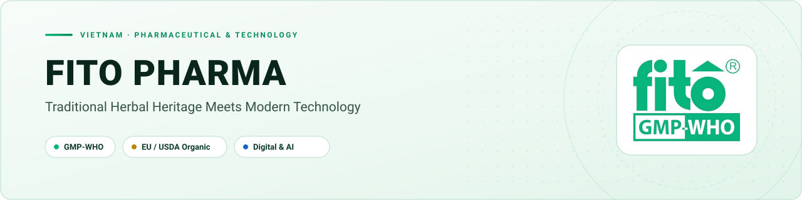

  <picture>
    <source media="(prefers-color-scheme: dark)" srcset="./assets/banner-dark.svg">
    <source media="(prefers-color-scheme: light)" srcset="./assets/banner-light.svg">
    
  </picture>

    

  

    
    
    
  

---

### About Fito Pharma

**Fito Pharmaceutical Co., Ltd. (Fito Pharma)** is a Vietnamese pharmaceutical enterprise dedicated to bridging centuries-old traditional herbal medicine with modern scientific manufacturing and international quality standards (**GMP-WHO**, **ISO**, **EU / USDA / JAS Organic**).

> *"Dedicated to protecting humanity's most precious asset — health."*

This GitHub Organization is the engineering home for our digital transformation initiatives, internal platforms, and applied technology projects.

---

### Technology Focus

<table>
  <tr>
    <td width="33%" valign="top">
      <h4>Digital Operations</h4>
      
Building reliable internal applications, workflow automation, and operational tooling to support pharmaceutical manufacturing and distribution.

    </td>
    <td width="33%" valign="top">
      <h4>Applied AI &amp; Data</h4>
      
Integrating practical AI workflows, knowledge management, and data-driven tools to boost team productivity across departments.

    </td>
    <td width="33%" valign="top">
      <h4>Security &amp; Reliability</h4>
      
Maintaining secure, resilient, and well-documented systems with least-privilege access and modern engineering standards.

    </td>
  </tr>
</table>

---

### Connect With Us

- **Official Website:** [fito.vn](https://fito.vn)
- **General Inquiries:** [info@fito.vn](mailto:info@fito.vn)
- **Cultural Heritage:** [FITO Museum — Museum of Traditional Vietnamese Medicine](https://fitomuseum.com.vn/)

---

  © Fito Pharmaceutical Co., Ltd. All rights reserved.

